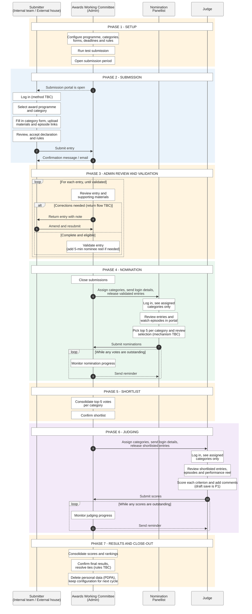

# Product Requirements Document (PRD)

---

## Executive Summary

**Product Name:** Mediacorp Awards Portal
**Problem Statement:**  
Mediacorp currently uses Stemcore to manage its four award programmes: Pradhana Vizha (PV), Star Awards (SSA), Pesta Perdana (PP) and Media Screen Awards (MSA). The current platform has limitations in stability and user experience, and there is a need to better support the different stakeholders involved in submissions, administration, nominations and judging.

**Proposed Solution:**  
Explore a centralised awards management platform with four main areas: Submission, Admin, Nomination and Judging. The platform should provide secure, role-based access, support the review of submitted media, enable progress tracking and reminders, and allow award configurations to be reused for future years.

**Success Metrics:**  
- Improve platform stability and availability during submission, nomination and judging periods (target: to be determined)
- Reduce manual administrative work involved in managing submissions, panel assignments and progress tracking (target: to be determined).
- Achieve successful completion of submissions, nominations and judging within their respective deadlines (target: to be determined).

---

## Background & Context

### User Research & Insights
- **Research Methods:** Initial BU discussions, review of existing requirements and workflows, Stemcore research (pending access) and Award Force research.
- **Key Findings:**
  - Dashboard needs to support four awards programmes
  - Four stakeholder groups require different access and functions
  - The process involves multiple stages, from submission to winner confirmation.
  - Secure media storage, video playback and progress tracking are key considerations.

---

## Goals & Success Criteria

### Business Goals
1. Establish a centralised platform to manage the four Mediacorp award programmes : PV, SSA, PP and MSA
2. imporove efficiency of submission, nomination, jusdging anf administrative processes
3. Provide a platform that can be reused and configured for future award cycles

### User Goals
1. Submitters: Easily submit, manage and track award entries.
2. Admins: Manage submissions, categories, users, panellists, judges and results efficiently.
3. Nomination Panellists: Review entries within assigned categories and select nominees.
4. Judges: Review shortlisted entries and submit scores based on judging criteria.
5. All Users: Access the information and functions relevant to their roles without viewing unauthorised information.

---

## User Personas & Use Cases

### Primary Persona 1 : Awards Working Committee Admin
- **Role:** Internal committee member responsible for managing the awards process - still unclear what the exact responsibilities are
- **Goals:** Configure programmes and categories, manage submissions and users, assign panellists and judges, monitor progress, and consolidate results - clarify
- **Pain Points:** Coordinating multiple stakeholders, tracking progress, and managing different requirements across award programmes
- **Technical Proficiency:** TBC
- **Context:** Uses the Admin Portal throughout the awards cycle

### Primary Persona 2 : Submitter/Production Houses
- **Role:** Internal production team member or external production house representative submitting award entries. - still unclear what the exact responsibilities are
- **Goals:** Submit entries, upload supporting materials, and track submission status. - clarify
- **Pain Points:** Understanding category requirements, completing submission forms, and ensuring all required materials are provided.
- **Technical Proficiency:** TBC
- **Context:** Uses the Submission Portal during the submission period

### Primary Persona 3 : Nomination Panellist
- **Role:** Assigned panellist responsible for reviewing entries and selecting nominees. - still unclear what the exact responsibilities are
- **Goals:** Access assigned categories, review submissions and supporting materials, and submit nominations - clarify
- **Pain Points:** Reviewing multiple entries and completing nominations within the given timeframe
- **Technical Proficiency:** TBC
- **Context:** Uses the Nomination Portal during the nomination period

### Primary Persona 4 : Judge
- **Role:** Assigned judge responsible for evaluating shortlisted entries - still unclear what the exact responsibilities are
- **Goals:** Review shortlisted entries, assess them against judging criteria, and submit scores and comments - clarify
- **Pain Points:** Accessing large video files, evaluating multiple entries, and completing scoring within the judging period
- **Technical Proficiency:** TBC
- **Context:** Uses the Judging Portal during the judging period

### Key Use Cases

#### Use Case 1: Submit an Award Entry
**Actor:** Submitter 
**Preconditions:** Submission period is open and the submitter has portal access. -  clarify
**Flow:**
1. Submitter logs in using their account details or the agreed login method (to be confirmed).
2. The portal displays the award programme(s) that the submitter is authorised to submit for.
3. Submitter selects the relevant award programme, if more than one is available to them.
4. Submitter selects the category they wish to submit an entry under.
5. The portal displays the submission form and requirements for that category.
6. Submitter fills in the required details, such as entry title, description, production information and other programme-specific fields.
7. Submitter uploads the required supporting materials, such as episodes, programme materials or performance reels.
8. Submitter reviews the completed form and uploaded files.
9. Submitter accepts the relevant declarations or terms, where applicable, and submits the entry.
10. The portal records the submission and displays a confirmation message. A confirmation email may also be sent.

**Expected Outcome:** Entry is successfully submitted and recorded in the portal. -  needs more clarity

**Edge Cases:** Missing mandatory fields, unsupported or oversized files, or submission deadline has passed.

#### Use Case 2: Awards Working Committee Admin
**Actor:** Awards Working Committee Admin 
**Preconditions:** Admin has portal access and submissions have been received -clarify
**Flow:**
1. Admin logs in using their authorised account.
2. The portal displays the Admin Dashboard, showing the award programmes available for management.
3. Admin selects the award programme they wish to configure.
4. Admin sets up the programme by configuring its categories, submission forms, deadlines and award phases
5. Admin sets up the relevant nomination rules and judging criteria for each category.
6. Admin adds or imports the relevant users, including submitters, panellists and judges, and manages their access permissions.
7. Admin prepares test accounts or submissions to check that the programme is configured correctly before launch, if a test environment is available.
8. Admin opens the submission period for the relevant award programme.
9. Admin monitors incoming submissions through the dashboard.
10. Admin reviews submitted entries and their supporting materials.
11. Admin checks whether entries meet the submission requirements and validates them.
12. If an entry requires corrections, Admin returns it to the submitter with a note explaining what needs to be amended.
13. Admin reviews the corrected entry once it has been resubmitted.
14. Once the submission period closes and entries have been validated, Admin prepares them for the nomination stage.
15. Admin assigns panellists to their respective categories.
16. Admin sends the panellists their login details and releases the relevant entries for review.
17. Admin monitors nomination progress through the dashboard, including which panellists have completed their votes.
18. Admin sends reminders to panellists who have not submitted their nominations.
19. Once nominations are completed, Admin consolidates the top-five votes for each category.
20. Admin reviews and confirms the shortlist before releasing it to the judges.
21. Admin assigns judges to their respective categories.
22. Admin sends the judges their login details and releases the shortlisted entries for judging.
23. Admin monitors judging progress through the dashboard.
24. Admin sends reminders to judges who have not submitted their scores.
25. Once judging is completed, Admin consolidates the scores and rankings.
26. Admin reviews and confirms the final results, including resolving ties where necessary.

**Expected Outcome:** Submissions are reviewed and the awards process is managed centrally. -  needs more clarity

**Edge Cases:** Incomplete or ineligible entries, incorrect category assignments, or entries requiring reopening.

#### Use Case 3: Review Entries and Submit Nominations
**Actor:** Nomination Panellist 
**Preconditions:** Nomination period is open and entries have been assigned to the panellist. - clarify
**Flow:**
1. Panellist logs in using the login details provided by the Admin.
2. The portal directs the panellist to the relevant award programme based on their assigned access.
3. The portal displays only the categories assigned to that panellist.
4. Panellist selects a category to review.
5. The portal displays the entries submitted under that category.
6. Panellist selects an entry to view its details, including the submission information and supporting materials.
7. Panellist reviews the entry and watches the relevant episodes or performance reels directly within the portal.
8. Panellist repeats the review process for the other entries in the assigned category.
9. Panellist selects their top five entries for that category, according to the nomination rules. 
10. The portal displays the selected entries for the panellist to review before submission.
11. Panellist confirms and submits their nominations.
12. The portal records the nominations and updates the submission status.

**Expected Outcome:** Nominations are recorded for the assigned categories. -  needs more clarity

**Edge Cases:** Incomplete entries, inaccessible supporting materials, or nomination deadline has passed.

#### Use Case 4: Evaluate Shortlisted Entries
**Actor:** Judge
**Preconditions:** Judging period is open and shortlisted entries have been assigned to the judge.
**Flow:**
1. Judge logs in using the login details provided by the Admin.
2. The portal directs the judge to the relevant award programme based on their assigned access.
3. The portal displays only the categories assigned to that judge.
4. Judge selects a category to review.
5. The portal displays the shortlisted entries for that category.
6. Judge selects an entry to view its details, including submission information and supporting materials.
7. Judge watches the relevant episodes or performance reels directly within the portal.
8. Judge reviews the entry against the judging criteria provided for that category.
9. Judge enters scores for each judging criterion and adds comments where required.
10. Judge saves their scores, where draft saving is supported.
11. Judge reviews the completed scores before submitting them.
12. Judge submits the scores for the category.
13. The portal records the scores and updates the judging status.

**Expected Outcome:** EJudging scores and comments are recorded for the assigned entries. -  needs more clarity

**Edge Cases:** Inaccessible videos, incomplete scoring, or judging deadline has passed.

---

## Product Requirements

### Functional Requirements

#### Must Have (P0) - MVP
1. **User Registration, Authentication and Access Control [BU + Internal]**
   - **Description:** Provide secure access to the four portal areas, with permissions appropriate to each stakeholder.
   - **User Story:** As a portal user, I want to log in securely and access only the functions relevant to my role so that I can carry out my responsibilities.
   - **Acceptance Criteria:**
     - [ ] Each stakeholder can access their own assigned portal (Eg, Nomination Panellists can access the Nomination Panel Portal.)
     - [ ] The system supports secure user authentication
     - [ ] Admin access is controlled according to assigned administrative permissions.
     - [ ] Panellists and judges can only access their assigned categories and entries.

2. **Award Programme and Category Support [BU]**
   - **Description:** Support the different award programmes, categories and category-specific submission requirements.
   - **User Story:** As an Admin, I want the portal to support different award programmes and categories so that each programme can follow its own submission requirements.
   - **Acceptance Criteria:**
     - [ ] The portal supports Pradhana Vizha (PV), Star Awards (SSA), Pesta Perdana (PP) and Media Screen Awards (MSA).
     - [ ] The portal supports performance categories, which recognise individual performers.
     - [ ] The portal supports programme categories, which recognise television programmes or productions.
     - [ ] The portal supports the different categories and requirements under MSA.
     - [ ] Each category can have its own relevant submission fields.
     - [ ] Special categories can include additional information fields where required, such as composer and lyricist details for Best Theme Song. (Eg, MSA)

3. **Award Entry Submission [BU]**
   - **Description:** Allow internal production teams and external production houses to submit entries and supporting materials for the relevant award categories.
   - **User Story:** As a Submitter, I want to submit an entry with all the required information and supporting materials so that it can be considered for an award.
   - **Acceptance Criteria:**
     - [ ] Submitters can submit entries under the available award categories.
     - [ ] The portal provides submission forms with fields relevant to each award category.
     - [ ] Submitters can upload relevant photographs and supporting documents, episode links and other relevant video content. 
     - [ ] The portal displays the relevant rules and regulations for each award programme.
     - [ ] Submitters must acknowledge the applicable declaration and submission requirements.
     - [ ] The Awards Working Committee can perform test submissions.

4. **Secure Storage and Data Management [BU + Internal]**
   - **Description:** Store submitted entries, supporting materials, user information and award information securely.
   - **User Story:** As an Admin, I want submissions and supporting materials to be stored securely so that award information can be accessed and managed appropriately.
   - **Acceptance Criteria:**
     - [ ] The portal provides secure cloud storage for submitted episodes, programme materials and performance reels.
     - [ ] The portal supports storage of uploaded photographs, videos and documents.
     - [ ] Personal and confidential information is protected.
     - [ ] Submissions, users and award information are maintained in a centralised database.
     - [ ] Voting information is stored securely.
     - [ ] Data backup and recovery arrangements are provided.

5. **Admin Submission Review and Management [BU + Internal]**
   - **Description:** Allow the Awards Working Committee to review, manage and modify submitted entries before they proceed to nomination and judging.
   - **User Story:** As an Admin, I want to review and manage submitted entries so that the information is ready for the next stage of the awards process.
   - **Acceptance Criteria:**
     - [ ] Admin can view all submitted entries and manage submission information across the different award programmes.
     - [ ] Admin can review the information and supporting materials for each entry.
     - [ ] Admin can check, modify, validate and return submitted entries
     - [ ] Admin can upload additional materials, including five-minute nominee performance reels for judging.

6. **Nomination and Judging Panel Management [BU + Internal]**
   - **Description:** Allow the Awards Working Committee to manage nomination panellist and judge information, assignments and portal access.
   - **User Story:** As an Admin, I want to manage panel members and their category assignments so that they can access the correct entries for their responsibilities.
   - **Acceptance Criteria:**
     - [ ] Admin can update nomination panel information and judging panel information in the system.
     - [ ] Admin can assign award categories to nomination panellists and judges
     - [ ] Admin can assign validated entries to the nomination panel and judges for voting.
     - [ ] Admin can send login information to nomination panellists and judges.
     - [ ] Admin can manage and distribute login information to the relevant users.

7. **Nomination Panel Review and Voting [BU + Internal]**
   - **Description:** Allow Nomination Panellists to review entries in their assigned categories and submit their top-five votes.
   - **User Story:** As a Nomination Panellist, I want to review entries and cast my top-five votes so that nominees can be shortlisted for judging.
   - **Acceptance Criteria:**
     - [ ] Panellists can view the award categories assigned to them.
     - [ ] Panellists can only access their assigned categories and entries.
     - [ ] Panellists cannot view the identities of other panellists.
     - [ ] Panellists can view a summary of each assigned entry.
     - [ ] Panellists can review submitted episodes.
     - [ ] Panellists can cast their top-five votes for each applicable category.
     - [ ] The portal records submitted votes.
     - [ ] The portal tracks voting progress.
     - [ ] Panellists can identify categories for which votes have not yet been submitted.
     - [ ] Voting information is kept confidential.

8. **Judging Panel Review and Scoring [BU + Internal – Process to Confirm]**
   - **Description:** Allow Judges to review assigned shortlisted entries and complete the required evaluation.
   - **User Story:** As a Judge, I want to review shortlisted entries and evaluate them using the relevant judging criteria so that the entries can be assessed.
     - [ ] Judges can view the award categories assigned to them.
     - [ ] Judges can only access their assigned categories and nominees.
     - [ ] Judges cannot view the identities of other judges.
     - [ ] Judges can view a summary of each assigned entry.
     - [ ] Judges can review submitted episodes and relevant performance reels.
     - [ ] Judges can evaluate entries using the relevant judging criteria.
     - [ ] Judges can input and submit their scores.
     - [ ] The portal records submitted scores
     - [ ] The portal tracks judging progress.
     - [ ] Judges can identify categories for which scores have not yet been submitted.
     - [ ] The portal supports the required restrictions on changing scores after submission, once the workflow is confirmed.

9. **Admin Progress Monitoring [BU + Internal]**
   - **Description:** Allow the Awards Working Committee to monitor nomination and judging progress and identify outstanding work.
   - **User Story:** As an Admin, I want to monitor the progress of panellists and judges so that I can follow up on outstanding votes and scores.
   - **Acceptance Criteria:**
     - [ ] Admin can monitor nomination panellists' and judges' progress.
     - [ ] Admin can identify panellists and judges who have not submitted their votes.
     - [ ] Admin can monitor progress across the different award categories.
     - [ ] The system records voting submissions and timestamps.

10. **Audit Logs and Activity Tracking [BU + Internal]**
   - **Description:** Maintain records of user access and important changes or administrative activities performed within the portal.
   - **User Story:** As an Admin, I want to track important user activities and changes so that actions within the portal can be traced.
   - **Acceptance Criteria:**
     - [ ] The portal records user access and login activities.
     - [ ] The portal records important administrative actions and changes.
     - [ ] The portal records relevant changes to submissions.

11. **Reusable Award Configurations and Data Protection [BU]**
   - **Description:** Retain the portal's structure and configurations for future award years while managing personal data in accordance with PDPA requirements.
   - **User Story:** As an Admin, I want to reuse award configurations in future years while ensuring personal data is handled appropriately so that the portal can support recurring award cycles.
   - **Acceptance Criteria:**
     - [ ] Award configurations can be reused without rebuilding the portal setup each year.
     - [ ] Personal data is deleted appropriately in accordance with PDPA requirements.
     - [ ] Reusable configurations are retained when personal data is deleted.

#### Should Have (P1) - Post-Launch
1. **Draft Saving and Autosave [Internal]**
   - **Description:** Allow Submitters, Nomination Panellists and Judges to save incomplete work and return to it later.
   - **User Story:** As a portal user, I want my work to be saved automatically or as a draft so that I can continue where I left off.
   - **Acceptance Criteria:**
     - [ ] Submitters can save incomplete entries as drafts.
     - [ ] Submitters can return to incomplete submissions before the deadline.
     - [ ] Nomination Panellists and Judges can save incomplete voting progress.

2. **Submission Validation and Completion Tracking [Internal]**
   - **Description:** Help Submitters identify incomplete or invalid information before submitting an entry.
   - **User Story:** As a Submitter, I want the portal to identify missing information and show my submission progress so that I can complete my entry correctly.
   - **Acceptance Criteria:**
     - [ ] The portal validates mandatory fields.
     - [ ] The portal checks uploaded files against the required file types and size limits.
     - [ ] The portal identifies missing information and attachments.
     - [ ] The portal displays submission status and deadlines.
     - [ ] The portal displays a submission completion percentage.

3. **Automated Notifications and Reminders [BU + Internal]**
   - **Description:** Provide automated email confirmations, login information and reminders to relevant users.
   - **User Story:** As a portal user, I want to receive relevant notifications and reminders so that I can complete my tasks within the required deadlines.
   - **Acceptance Criteria:**
     - [ ] Submitters receive email confirmation after submitting an entry.
     - [ ] Submitters receive relevant submission reminders.
     - [ ] Submitters, Nomination Panellists and Judges receive login information and automated reminders.
     - [ ] Nomination Panellists and Judges receive automated reminders.
     - [ ] Admin can send reminders for pending tasks.
     - [ ] The portal can identify users with outstanding submissions, votes or scores.

4. **Admin Dashboard and Task Management [BU + Internal]**
   - **Description:** Provide a central dashboard for the Awards Working Committee to monitor award progress and outstanding tasks.
   - **User Story:** As an Admin, I want to view key statistics and outstanding tasks in one place so that I can manage the awards process more efficiently.
   - **Acceptance Criteria:**
     - [ ] The dashboard displays key statistics for the award programmes.
     - [ ] Admin can filter information by award programme, category and submission status.
     - [ ] Admin can search for relevant entries and users.
     - [ ] Admin can access a centralised view of outstanding tasks and votes

5. **Nomination and Judging Progress Indicators [BU + Internal]**
   - **Description:** Provide clear progress indicators to help panellists and judges track their assigned work.
   - **User Story:** As a panellist or judge, I want to see the status of my assigned categories so that I know which tasks I have completed and which remain outstanding.
   - **Acceptance Criteria:**
     - [ ] Panellists can review their own selections before submitting.
     - [ ] Judges can view clear scoring criteria and evaluation fields.
     - [ ] The Judge Portal uses the proposed colour indicators for the progress indicator: white for scoring not completed, yellow for completed but not submitted, and green for submitted.

6. **Results Consolidation and Report Export [BU + Internal]**
   - **Description:** Allow the Awards Working Committee to consolidate nomination and judging information and export relevant reports.
   - **User Story:** As an Admin, I want to consolidate and export award information so that I can review results and prepare reports.
   - **Acceptance Criteria:**
     - [ ] Admin can view consolidated scores.
     - [ ] Admin can export entries, shortlists, scores and results.
     - [ ] The portal supports exporting reports to Excel and PDF.
     - [ ] Admin can generate reports across award categories and programmes.

7. **Admin Test Submissions and Testing Environment [BU + Internal]**
   - **Description:** Allow the Awards Working Committee to test portal functions and submissions before the live award cycle.
   - **User Story:** As an Admin, I want to test submissions and portal functions so that I can identify issues before the live process begins.
     - [ ] The Awards Working Committee can create test submissions.
     - [ ] Test accounts can be created for checking portal functions.
     - [ ] Test submissions do not affect live award records if a separate test environment is implemented.
     - [ ] Test data can be removed before launch.

#### Nice to Have (P2) - Future Consideration
1. **AI-Assisted Submission Checks and Summaries [Internal]**
   - **Description:** Explore AI-assisted functions to help review submission information and generate summaries.
   - **User Story:** As an Admin, I want assistance with reviewing and summarising entries so that I can process submissions more efficiently.
   - **Acceptance Criteria:**
     - [ ] The portal can provide AI-assisted checks on submitted information.
     - [ ] The portal can generate summaries of submitted entries.
     - [ ] AI-generated information can be reviewed by an authorised user before being used.

2. **Historical Winners Database [BU + Internal]**
   - **Description:** Maintain an online database of past award winners and allow the Working Committee to add winners for the current award year.
   - **User Story:** As an Admin, I want to maintain historical winners' records so that past award results can be referenced in future years.
   - **Acceptance Criteria:**
     - [ ] Admin can view historical winners' records.
     - [ ] Admin can add winners for the current award year.
     - [ ] Winners' records can be organised by award programme and year.

3. **Eligible Artistes Database [BU]**
   - **Description:** Maintain an online database of artistes eligible for popularity award categories.
   - **User Story:** As an Admin, I want to maintain eligible artistes' information so that their eligibility for popularity award categories can be tracked.
   - **Acceptance Criteria:**
     - [ ] Admin can maintain a list of eligible artistes.
     - [ ] The portal can record artistes' years of experience.
     - [ ] The portal can use the relevant information to determine eligibility for popularity award categories.

4. **Integration with Internal Platforms and Services [Internal]**
   - **Description:** Explore integration with other internal Mediacorp platforms and services.
   - **User Story:** As an Admin, I want the awards portal to connect with relevant internal platforms so that information can be shared where required.
   - **Acceptance Criteria:**
     - [ ] Potential internal systems for integration can be identified.
     - [ ] Integration requirements and data exchange methods can be evaluated.
     - [ ] Any integration must comply with internal security and access requirements.

---

## User Experience & Design

### User Flow Diagram

*Lanes show who acts at each stage. Steps marked TBC depend on the open questions listed under Dependencies & Risks.*

The user flow covers the four main stakeholders: Submitter, Admin, Nomination Panellist and Judge, from login through to submission, review, voting, judging and result consolidation.

### Wireframes/Mockups
Interactive HTML wireframe: [Open the wireframe](./awards_portal_wireframe.html)

Open it in a browser. Use the role buttons at the top to switch between Submitter, Admin, Nomination Panellist and Judge. "Reset demo" restores the starting state.

Key Screens:
- Submitter dashboard
- Award entry submission form
- Admin dashboard
- Nomination panel dashboard
- Judge dashboard
- Entry review and video playback screen
- Judging and scoring interface

### Key Interactions
1. **Award Entry Submission**
   - **Trigger:** Submitter selects an award programme and category.
   - **Behavior:** The relevant submission form appears, allowing the submitter to enter details and upload supporting materials. The submitter can save the entry as a draft or submit it.
   - **Feedback:** The system highlights missing or invalid fields and displays a confirmation after successful submission.

2. **Admin Review and Validation**
   - **Trigger:** Admin opens a submitted entry from the dashboard.
   - **Behavior:** Admin reviews and validates the entry, approves it or returns it to the submitter for amendments.
   - **Feedback:** The entry status is updated, and the submitter is notified if amendments are required.

3. **Nomination Panel Voting**
   - **Trigger:** Panellist opens an assigned award category.
   - **Behavior:** Panellist reviews the submitted entries and selects the top five nominees.
   - **Feedback:** A running selection count is displayed, allowing the panellist to review their choices before submitting.

4. **Judging and Scoring**
   - **Trigger:** Judge opens an assigned category and shortlisted entries.
   - **Behavior:** Judge reviews entry details, watches the submitted videos and scores each entry against the judging criteria.
   - **Feedback:** Scoring progress is displayed, and the system confirms when scores are submitted.

5. **Admin Progress Monitoring**
   - **Trigger:** Admin opens the progress dashboard
   - **Behavior:** Admin views submission, nomination and judging progress across categories and panel members.
   - **Feedback:** Pending tasks are highlighted so Admin can identify outstanding votes or scores and send reminders.

### Design Principles for This Product
- Clear progress visibility: Use clear status indicators to show completed and pending submissions, votes and scores.
- Centralised review: Allow panellists and judges to review entry details and watch videos directly within the portal.
- Security and confidentiality: Restrict access to assigned categories and keep panel member identities confidential.
- Clear feedback: Provide confirmation messages, validation errors and status updates for important actions.

---

## Open Questions

#### Access and users
1.	Who is allowed access to each portal? What portals can the admin access?
2.  How many panellists and judges does each programme have?
3.	How should login work for panellists and judges (emailed credentials, one-time link, SSO)? Is there a password reset?
4.	Do all four award programmes use the same platform and login system?

#### Categories, forms and fields
1. Please provide the full list of categories per Awards programme (PV, SSA, PP, MSA) and each category type.
2. For each category, please provide the full list of the fields? Please share the current Stemcore form as a baseline.
3. What are the field limits: character or word counts for synopsis and bios, and bilingual fields (EN plus Chinese, Malay, Tamil)?
4.	What are the file requirements: maximum size per file and per submission, accepted formats, maximum number of photos and documents, image resolution and dimensions, and video length, resolution and format?
5.	Are episodes submitted as links or uploaded files? 
6.	Which categories need extra fields (such as Best Theme Song), and what are the fields?

#### Submission rules
1.	Can a submitter save a draft? Can they edit after submitting, and until when?
2.	Are late submissions allowed, and who approves them?
3.	Which rules and declaration text apply to each programme?

#### Admin portal
1.	What exactly do they check for each submission entry?
2.	Can admins edit categories and fields?
3.	Can admins return an entry to the submitter for corrections?
4.	Can admins reject or disqualify an entry? What happens afterwards?
5.	Do admins need to configure each award themselves (categories, forms, deadlines), or will that be set up once by IT?
6.	Is there an approval step before a category is released to panellists? What happens if one is missed?
7.	What do admins need to see on the dashboard, and what reports do they need to export?
8.	Should test submissions take place in a separate testing environment rather than the live portal?

#### Nomination panel
1.	How should the system show voting progress: not started, in progress or submitted? What else must panellists see?
2.  Should the nomination panellist see the submitter’s identity, or should entries be anonymised?
3.	What exactly should appear in each submission entry summary? 
4.	What is the voting mechanism?
5.	Can a vote be changed after submitting? Can admin reopen it?

#### Judging and scoring
1. What is the voting mechanism?
2. Can a vote be changed after submitting? Can admin reopen it?
3. What exactly should appear in the entry summary?
4. Should the judge see the nomination panellist’s identity, or should entries be anonymised?

#### Configurability and reuse
1.	Should forms, categories and criteria be configurable by admins, or fixed per year?
2.	When data is cleared for PDPA, what is kept (forms, categories, users) and what is deleted, and when? Can historical award configurations be reused while personal data and old submissions are deleted?
3.	Are winners kept in the system, for how long, and who approves deletion?

#### Non-functional and operations
1.	Which notifications and reminders are needed (login details, deadline reminders, confirmations)?
2.	What audit logs are required, and who reviews them?
3.	Does the system need to migrate historical entries and user records from Stemcore?
4.	Are there existing systems that need to integrate with the new portal?

#### Wish list and data availability
1.	Does the BU have historical winners’ records? How many years are available?
2.	Does the BU have an existing eligible artistes database (names, years of experience, eligibility rules)?

---
