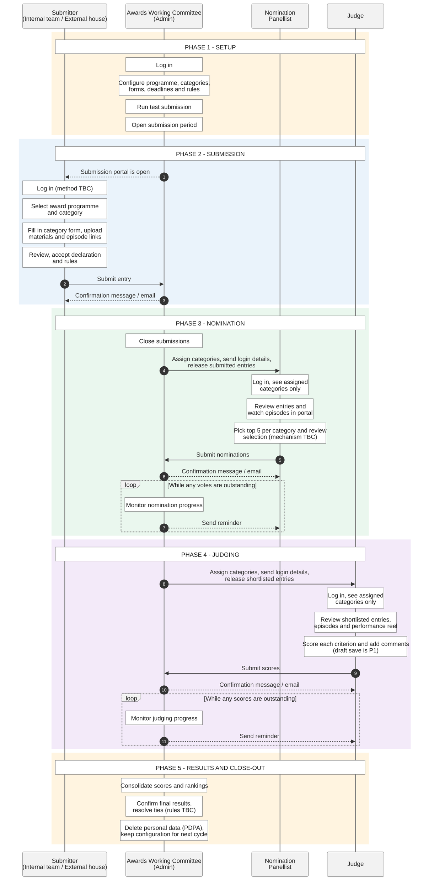

# Product Requirements Document (PRD)

---

## Executive Summary

**Product Name:** Mediacorp Awards Portal

**Problem Statement:**  
Mediacorp currently uses Stemcore to manage its four award programmes: Pradhana Vizha (PV), Star Awards (SSA), Pesta Perdana (PP) and Media Screen Awards (MSA). The current platform has limitations in stability and user experience, and there is a need to better support the different stakeholders involved in submissions, administration, nominations and judging.

**Proposed Solution:**  
Explore a centralised awards management platform with four main areas: Submission, Admin, Nomination and Judging. The platform should provide secure, role-based access, support the review of submitted media, enable progress tracking and reminders, and allow award configurations to be reused for future years.

---

## Background & Context

### User Research & Insights
- **Research Methods:** Initial BU discussions, review of existing requirements and workflows, Stemcore research (pending access) and Award Force research.
- **Key Findings:**
  - Dashboard needs to support four awards programmes
  - Four stakeholder groups require different access and functions
  - The process involves multiple stages, from submission to winner confirmation.
  - Secure media storage, video playback and progress tracking are key considerations.

---

## User Personas & Use Cases

### Primary Persona 1 : Awards Working Committee Admin
- **Role:** Internal committee member responsible for managing the awards process
- **Goals:** Configure programmes and categories, manage submissions and users, assign panellists and judges, monitor progress, and consolidate results
- **Pain Points:** Coordinating multiple stakeholders, tracking progress, and managing different requirements across award programmes

### Primary Persona 2 : Submitter/Production Houses
- **Role:** Internal production team member or external production house representative submitting award entries.
- **Goals:** Submit entries, upload supporting materials, and track submission status.
- **Pain Points:** Understanding category requirements, completing submission forms, and ensuring all required materials are provided.
  
### Primary Persona 3 : Nomination Panellist
- **Role:** Assigned panellist responsible for reviewing entries and selecting nominees.
- **Goals:** Access assigned categories, review submissions and supporting materials, and submit nominations
- **Pain Points:** Reviewing multiple entries and completing nominations within the given timeframe

### Primary Persona 4 : Judge
- **Role:** Assigned judge responsible for evaluating shortlisted entries
- **Goals:** Review shortlisted entries, assess them against judging criteria, and submit scores and comments 
- **Pain Points:** Accessing large video files, evaluating multiple entries, and completing scoring within the judging period

### Key Use Cases (simplified workflow)

#### Use Case 1: Submit an Award Entry
**Actor:** Submitter 

**Flow:**
Flow: Submission period open → log in → choose programme and category → complete form and upload materials → accept declaration → submit → confirmation

**Edge Cases:** Missing mandatory fields, unsupported or oversized files, or submission deadline has passed.

#### Use Case 2: Manage the awards process
**Actor:** Awards Working Committee Admin 

**Flow:**
Set up programme and users → open submissions → validate or return entries → assign panellists and judges, release entries → monitor and send reminders → consolidate top-5 votes into shortlist → consolidate scores → confirm results (resolve ties)

**Edge Cases:** Incomplete or ineligible entries, incorrect category assignments, or entries requiring reopening.

#### Use Case 3: Nominate or score
**Actor:** Nomination Panellist/Judge

**Flow:**
Period open and categories assigned → log in → see assigned categories only → review entries and watch episodes in portal → panellist picks top 5 / judge scores each criterion and comments → review → submit

**Edge Cases:** Incomplete entries, inaccessible supporting materials, or nomination deadline has passed.

---

## Product Requirements

### Functional Requirements

#### Must Have (P0) - MVP
1. **User Registration, Authentication and Access Control [BU + Internal]**
   - **Description:** Provide **secure access** to the four portal areas, with **permissions** appropriate to each stakeholder.
   - **Requirements:**
     - [ ] Each stakeholder can access their own assigned portal (Eg, Nomination Panellists can access the Nomination Panel Portal.)
     - [ ] The system supports secure user authentication
     - [ ] Admin access is controlled according to assigned administrative permissions.
     - [ ] Panellists and judges can only access their assigned categories and entries.

2. **Award Programme and Category Support [BU]**
   - **Description:** Support the different award programmes, categories and category-specific **submission requirements**.
   - **Requirements:**
     - [ ] The portal supports Pradhana Vizha (PV), Star Awards (SSA), Pesta Perdana (PP) and Media Screen Awards (MSA).
     - [ ] The portal supports performance and programme categories
     - [ ] Each category can have its own relevant submission fields.
     - [ ] Special categories can include additional information fields where required, such as composer and lyricist details for Best Theme Song. (Eg, MSA)

3. **Award Entry Submission [BU]**
   - **Description:** Allow internal production teams and external production houses to **submit entries and supporting materials for the relevant award categories.**
   - **Requirements:**
     - [ ] Submitters can submit entries under the available award categories.
     - [ ] The portal provides submission forms with fields relevant to each award category.
     - [ ] Submitters can upload relevant photographs and supporting documents, episode links and other relevant video content. 
     - [ ] The portal displays the relevant rules and regulations for each award programme.
     - [ ] Submitters must acknowledge the applicable declaration and submission requirements.

4. **Secure Storage and Data Management [BU + Internal]**
   - **Description:** **Storage** of submitted entries, supporting materials, user information and award information securely.
   - **Requirements:**
     - [ ] The portal provides secure cloud storage for submitted episodes, programme materials and performance reels.
     - [ ] The portal supports storage of uploaded photographs, videos and documents.
     - [ ] Personal and confidential information is protected.
     - [ ] Submissions, users, awards and voting information are maintained in a centralised database.
     - [ ] Data backup and recovery arrangements are provided.

5. **Admin Submission Review and Management [BU + Internal]**
   - **Description:** Allow the Awards Working Committee to **review, manage and modify submitted entries** before they proceed to nomination and judging.
   - **Requirements:**
     - [ ] Admin can view all submitted entries and manage submission information across the different award programmes.
     - [ ] Admin can review the information and supporting materials for each entry.
     - [ ] Admin can check, modify and validate submitted entries
     - [ ] Admin can upload additional materials
           
6. **Admin Dashboard and Task Management [BU + Internal]**
   - **Description:** Provide a **central dashboard** for the Awards Working Committee to monitor award progress and outstanding tasks.
   - **Requirements:**
     - [ ] Admin can filter information by award programme, category and submission status.
     - [ ] Admin can search for relevant entries and users.
     - [ ] Admin can access a centralised view of outstanding tasks and votes

7. **Nomination and Judging Panel Management [BU + Internal]**
   - **Description:** Allow the Awards Working Committee to **manage nomination panellist and judge information, assignments and portal access.**
   - **Requirements:**
     - [ ] Admin can update nomination panel information and judging panel information in the system.
     - [ ] Admin can assign award categories and validated entries for voting to nomination panellists and judges.
     - [ ] Admin can manage and distribute login information to nomination panellists and judges.
     - [ ] Admin can monitor nomination panellists' and judges' progress.
     - [ ] Admin can identify panellists and judges who have not submitted their votes.

8. **Nomination Panel Review and Voting [BU + Internal]**
   - **Description:** Allow Nomination Panellists to **review entries in their assigned categories and submit their top-five votes.**
   - **Requirements:**
     - [ ] Panellists can view and access the award categories and entries assigned to them
     - [ ] Panellists cannot view the identities of other panellists.
     - [ ] Panellists can view a summary of each assigned entry
     - [ ] Panellists can view relevant information such as performance reels and episodes of each assigned entry.
     - [ ] Panellists can cast their top-five votes for each applicable category.
     - [ ] The portal records submitted votes.
     - [ ] The portal tracks voting progress.
     - [ ] Panellists can identify categories for which votes have not yet been submitted.
     - [ ] The Nomination Portal uses the proposed colour indicators for the progress indicator: white for scoring not completed, yellow for completed but not submitted, and green for submitted.

9. **Judging Panel Review and Scoring [BU + Internal**
   - **Description:** Allow Judges to **review assigned shortlisted entries and complete the required evaluation.**
   - **Requirements:**
     - [ ] Judges can only view and access the award categories assigned to them.
     - [ ] Judges cannot view the identities of other judges.
     - [ ] Judges can view a summary of each assigned entry.
     - [ ] Judges can view relevant information such as performance reels and episodes of each shortlisted entry.
     - [ ] Judges can input and submit their scores.
     - [ ] The portal records submitted scores
     - [ ] The portal tracks judging progress.
     - [ ] Judges can identify categories for which scores have not yet been submitted.
     - [ ] The Judge Portal uses the proposed colour indicators for the progress indicator: white for scoring not completed, yellow for completed but not submitted, and green for submitted.

10. **Audit Logs and Activity Tracking [BU + Internal]**
   - **Description:** **Maintain records of user access and important changes or administrative activities** performed within the portal.
   - **Requirements:**
     - [ ] The portal records user access and login activities.
     - [ ] The portal records important administrative actions and changes.
     - [ ] The portal records relevant changes to submissions.

11. **Reusable Award Configurations and Data Protection [BU]**
   - **Description:** **Retain the portal's structure and configurations** for future award years while managing personal data in accordance with PDPA requirements.
   - **Requirements:**
     - [ ] Award configurations can be reused without rebuilding the portal setup each year.
     - [ ] Personal data is deleted appropriately in accordance with PDPA requirements.
     - [ ] Reusable configurations are retained when personal data is deleted.

#### Should Have (P1) - Post-Launch
1. **Draft Saving and Autosave [Internal]**
   - **Description:** Allow Submitters, Nomination Panellists and Judges to **save incomplete work** and return to it later.
   - **Requirements:**
     - [ ] Submitters can save incomplete entries as drafts.
     - [ ] Submitters can return to incomplete submissions before the deadline.
     - [ ] Nomination Panellists and Judges can save incomplete voting progress.

2. **Submission Validation and Completion Tracking [Internal]**
   - **Description:** Help Submitters **identify incomplete or invalid information before submitting** an entry.
   - **Requirements:**
     - [ ] The portal validates mandatory fields.
     - [ ] The portal checks uploaded files against the required file types and size limits.
     - [ ] The portal identifies missing information and attachments.
     - [ ] The portal displays submission status and deadlines.

3. **Automated Notifications and Reminders [BU + Internal]**
   - **Description:** Provide **automated email confirmations, login information and reminders** to relevant users.
   - **Requirements:**
     - [ ] Submitters receive email confirmation after submitting an entry.
     - [ ] Submitters, Nomination Panellists and Judges receive relevant automated reminders.
     - [ ] Admin can send reminders for pending tasks.
     - [ ] The portal can identify users with outstanding submissions, votes or scores.

4. **Admin Test Submissions and Testing Environment [BU + Internal]**
   - **Description:** Allow the Awards Working Committee to **test portal functions and submissions** before the live award cycle.
   - **Requirements**
     - [ ] The Awards Working Committee can create test submissions.
     - [ ] Test accounts can be created for checking portal functions.
     - [ ] Test submissions do not affect live award records if a separate test environment is implemented.
     - [ ] Test data can be removed before launch.

#### Nice to Have (P2) - Future Consideration
1. **AI-Assisted Submission Checks [Internal]**
   - **Description:** Explore **AI-assisted functions** to help review submission information and generate summaries.
   - **Requirements:**
     - [ ] The portal can provide AI-assisted checks on submitted information.
     - [ ] AI-generated information can be reviewed by an authorised user before being used.

2. **Historical Winners and Artistes Database [BU + Internal]**
   - **Description:** **Maintain an online database** of past award winners and allow the Working Committee to add winners for the current award year.
   - **Requirements:**
     - [ ] Admin can view and maintain historical winners' records.
     - [ ] Admin can view and maintain a list of eligible artistes.
     - [ ] Admin can add winners for the current award year.
     - [ ] Winners' records can be organised by award programme and year.
     - [ ] The portal can use the relevant information to determine eligibility for popularity award categories.
        
3. **Integration with Internal Platforms and Services [Internal]**
   - **Description:** Explore **integration with other internal Mediacorp platforms and services.**
   - **Requirements:**
     - [ ] Potential internal systems for integration can be identified.
     - [ ] Integration requirements and data exchange methods can be evaluated.
     - [ ] Any integration must comply with internal security and access requirements.

---

## User Experience & Design

### User Flow Diagram

*Lanes show who acts at each stage. Steps marked TBC depend on the open questions listed under Dependencies & Risks.*

The user flow covers the four main stakeholders: Submitter, Admin, Nomination Panellist and Judge, from login through to submission, review, voting, judging and result consolidation.

### Wireframes/Mockups
Interactive HTML wireframe: [Open the wireframe](./awards_portal_wireframe.html)

Key Screens:
- Submitter dashboard
- Award entry submission form
- Admin dashboard
- Nomination panel dashboard
- Judge dashboard

## Open Questions

#### Access and users
1.	Does the admin have access to all portals or just the admin portal?
2.  How many panellists and judges does each programme have?
3.	How are the admin sending out the login info, similtanuoesly to panellists and judges or individually? Via email or anything else? What is the login info (emailed credentials, one-time link, SSO)? Is there a password reset?
4.	Do all four award programmes use the same platform and login system?

#### Categories, forms and fields
1. Please provide the full list of category types (Eg, Performance) and categories (Eg, Best Actor) per Awards programme (PV, SSA, PP, MSA).
2. For each category, please provide the full list of the fields. Please share the current Stemcore form as a baseline.
3.	Which categories need extra fields (such as Best Theme Song), and what are the fields?

#### Submission rules
1.	What are the rules and declaration text? Is it the same for every Awards Programme?
2.	After submission, do admin get email, notif? Do the production houses get email, notif of submission confirmation?

#### Admin portal
1.	Powerpoint shows " To be able to review submitted entries " as crossed out, is it still needed?
2.	Powerpoint shows " Check or modify submitted entries " as crossed out, is it still needed? What exactly do they check for each submission entry? What exactly can they modify?
3.	Can admin send back the entry for changes or they just modify themselves?
4.	What does it mean by " Update nomination + judging panel to system for assignment of categories." ?
5.	Do the admin create the forms? Is the forms same or diff to each awards? Deadlines? Rules?
6.	Is there a validation/approval step before a category is released to panellists/judges? Is it done manually or automated?

#### Nomination panel
1.  Should the nomination panellist see the submitter’s identity, or should entries be anonymised?
2.	What exactly should appear in each submission entry summary? 
3.	What is the voting mechanism/voting criteria?
4.	Can a vote be changed after submitting? Can admin reopen it?
5.	What does it mean by " Able to ID which categories which scores they have yet submitted. ​"?

#### Judging and scoring
1.  Should the judge see the nomination panellist’s identity, or should the chosen entries be anonymised?
2.	What exactly should appear in each submission entry summary? 
3.	What is the voting mechanism/voting criteria?
4.	Can a vote be changed after submitting? Can admin reopen it?
5.	What does it mean by " Able to ID which categories which scores they have yet submitted. ​"?
   
#### Configurability and reuse
1.	Should forms, categories and criteria be configurable by admins, IT, or fixed per year?
2.	When data is cleared for PDPA, what is kept (forms, categories, users) and what is deleted, and when? Can historical award configurations be reused while personal data and old submissions are deleted?
3.	Are winners kept in the system, for how long, and who approves deletion?

#### Non-functional and operations
1.	Are reminders from admin needed. If they do, is it via email? Automated?
2.	What audit logs are required, and who reviews them?
3.	Does the system need to migrate historical entries and user records from Stemcore?
4.	Are there existing systems that need to integrate with the new portal?

---
